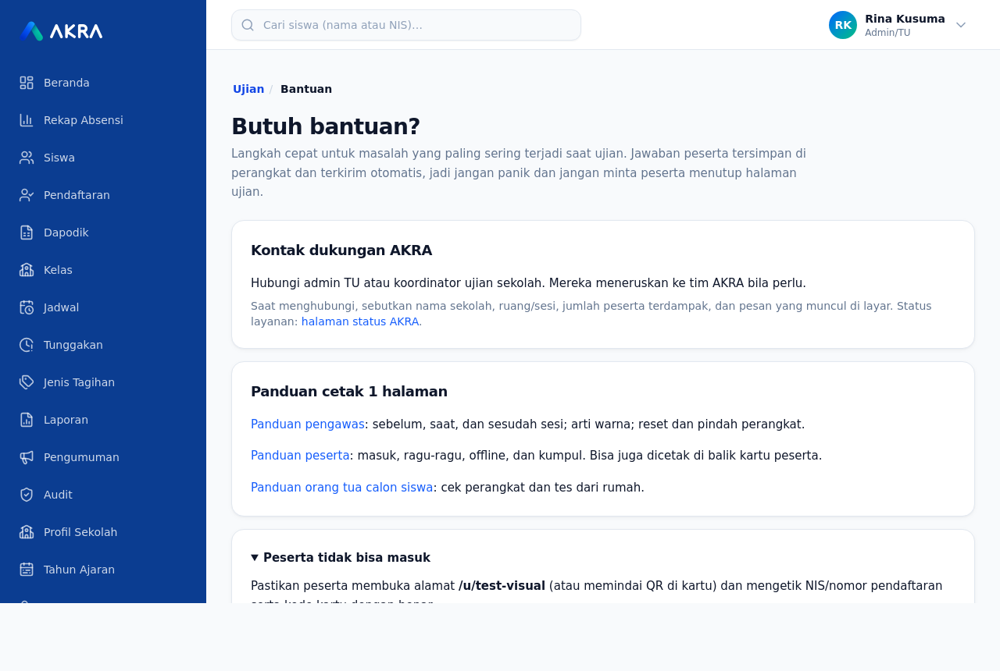
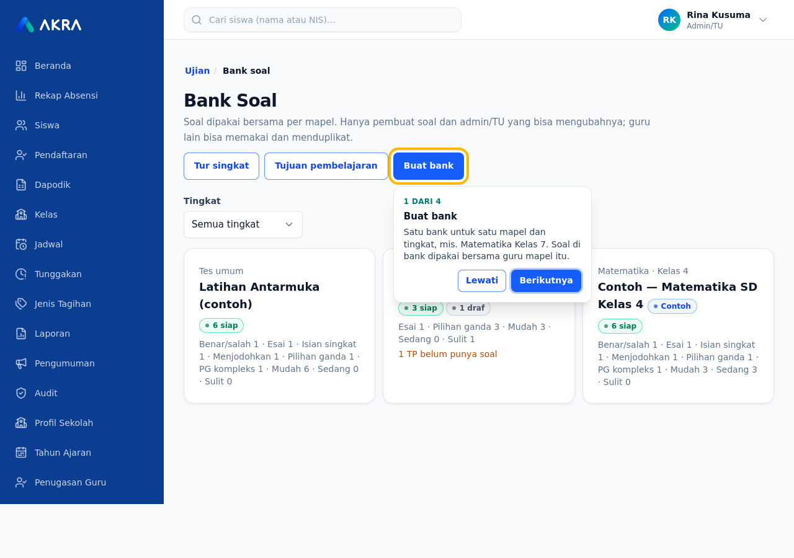

# Panduan Modul Ujian AKRA

Panduan untuk sekolah yang memakai modul ujian online AKRA. Ditulis untuk dibaca sendiri tanpa pelatihan panjang.

| Untuk | Panduan | Isi |
|---|---|---|
| Guru mapel | [guru.md](guru.md) | Bank soal, impor Word/Excel, membuat ulangan, koreksi esai, analisis, kirim ke rapor |
| Koordinator ujian dan admin TU | [koordinator.md](koordinator.md) | Agenda PTS/PAS, ruang, pembagian peserta dan pengawas, kartu, pusat kendali, susulan |
| Pengawas | [pengawas.md](pengawas.md) | Layar pengawas, arti warna, aksi yang sering dipakai |
| Tim AKRA | [uji-keterbacaan.md](uji-keterbacaan.md) | Cara menguji panduan dengan guru dan siswa sebelum dipakai sekolah |

## Panduan cetak 1 halaman

Panduan cetak dibuat langsung oleh AKRA dalam bentuk PDF A4, berisi alamat sekolah dan kontak dukungan:

| Panduan | Dari aplikasi (staf) | Tanpa login |
|---|---|---|
| Pengawas | Ujian → Bantuan → Panduan pengawas | – |
| Peserta | Ujian → Bantuan → Panduan peserta, atau centang **Panduan peserta di balik kartu** saat mencetak kartu | `/u/panduan/peserta.pdf` (tautan di halaman masuk peserta) |
| Orang tua calon siswa | Ujian → Bantuan → Panduan orang tua | `/u/panduan/orang-tua.pdf` (tautan di halaman status pendaftaran) |

Kartu peserta dengan panduan di baliknya dicetak **bolak-balik, dibalik di sisi panjang**. Setiap panduan tercetak tepat di balik kartunya.

## Bantuan di dalam aplikasi

- **Butuh bantuan?** (menu Ujian, layar pengawas, pusat kendali): langkah cepat untuk peserta tidak bisa masuk, HP mati, offline, layar terkunci, tidak ada bunyi, kunci salah, dan susulan. Kontak dukungan AKRA tampil bila sudah diatur. Selama musim PTS/PAS (7 hari sebelum agenda sampai agenda selesai) yang tampil jam layanan musim ujian.
- **Tanda ?** di samping istilah (varian, KKTP, daya beda, tingkat kesukaran, lokasi, TP, pengecoh) membuka penjelasan singkat.
- **Tur singkat** tampil sekali saat pertama membuka bank soal, wizard ujian, dan layar pengawas. Tur bisa dilewati, dan diputar ulang dengan tombol **Tur singkat**.
- **Halaman kosong** selalu berisi langkah berikutnya dan tombol aksinya.

## Konten contoh untuk sekolah baru

Saat staf pertama kali membuka menu Ujian, AKRA menyiapkan:

- **Bank contoh Matematika per jenjang** yang ada di sekolah: SD kelas 4, SMP kelas 8, SMA kelas 11. Jenjang dibaca dari tingkat kelas sekolah; sekolah tanpa kelas mendapat ketiganya. Isinya 7 soal: semua jenis soal, rumus, dan satu soal bergambar (diagram batang). Bank berlabel **Contoh** dan soalnya bertag `contoh`. Bila sekolah punya mapel Matematika, bank ditautkan ke mapel itu sehingga guru Matematika ikut melihatnya.
- **Coba Halaman Ujian**, paket latihan siap pakai untuk mengenalkan halaman ujian kepada siswa (tombol **Coba halaman ujian** di beranda modul dan di Daftar Ujian).
- **Template Word dan Excel resmi** di halaman impor setiap bank.

Konten contoh dibuat sekali, atas nama admin TU pertama sekolah. Bank contoh yang diarsipkan tidak dibuat ulang.

## Kontak dukungan (untuk tim AKRA)

Kontak di halaman bantuan dan panduan cetak diatur lewat variabel lingkungan server. Semuanya opsional; tanpa kontak, sekolah diarahkan ke admin TU sekolahnya sendiri.

| Variabel | Contoh | Keterangan |
|---|---|---|
| `SUPPORT_WHATSAPP` | `0812xxxxxxxx` | Tombol WhatsApp di halaman bantuan; ikut tercetak di panduan pengawas |
| `SUPPORT_EMAIL` | `bantuan@…` | Divalidasi saat server mulai |
| `SUPPORT_HOURS` | `Senin–Jumat 07.00–16.00 WIB` | Jam layanan biasa |
| `SUPPORT_HOURS_PEAK` | `Setiap hari 06.00–18.00 WIB` | Tampil selama musim PTS/PAS sekolah |

Isi kontak dan jam layanan sebelum pilot (T155).
