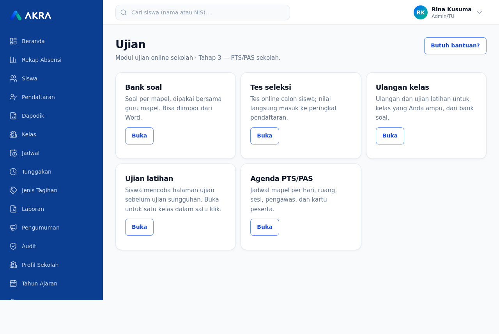
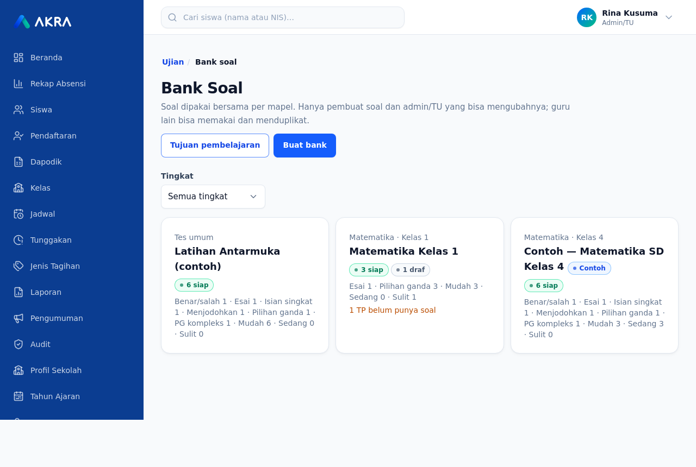
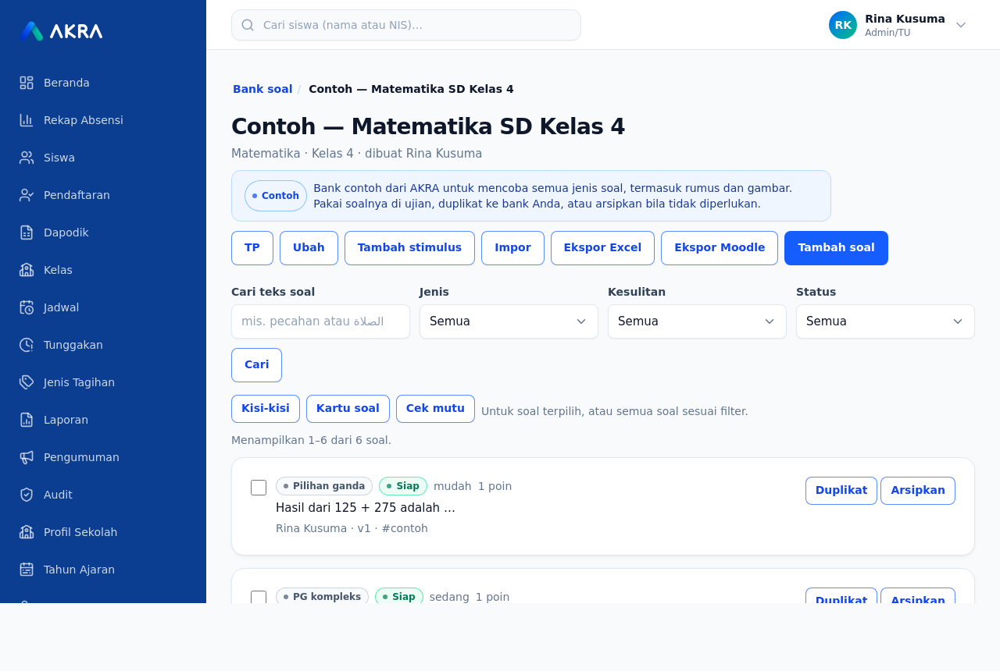
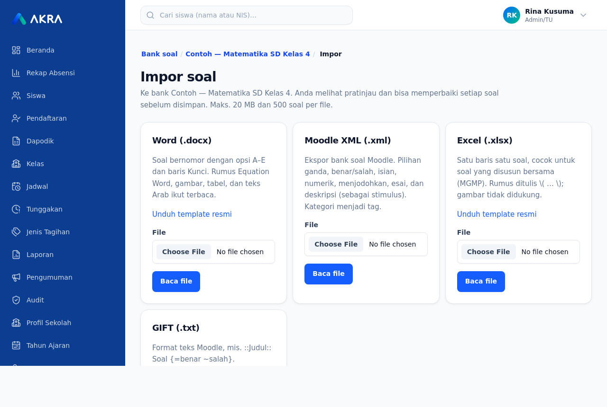
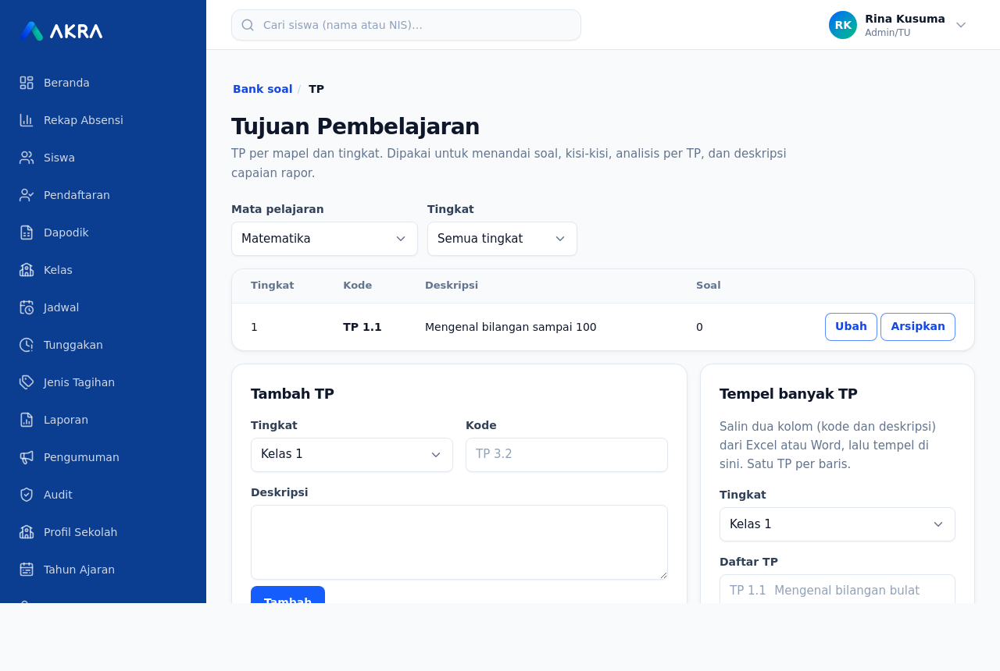
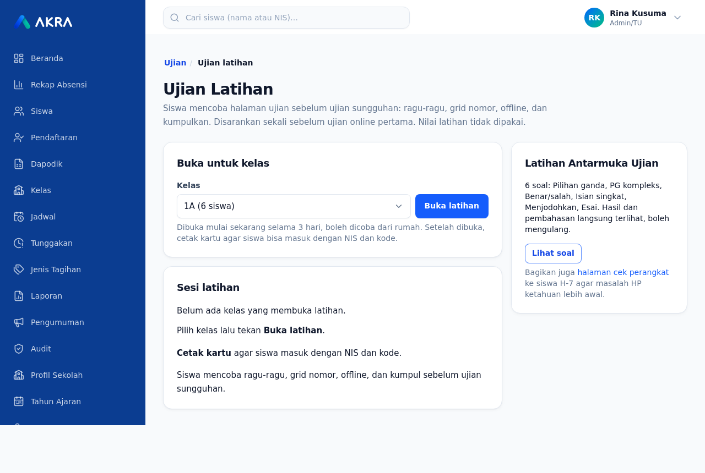
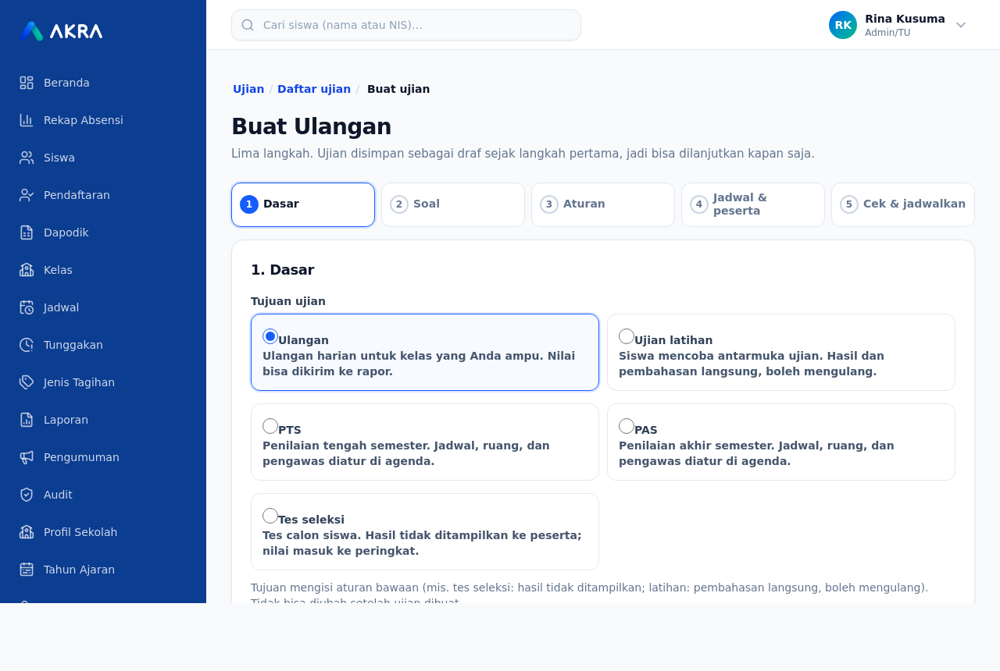
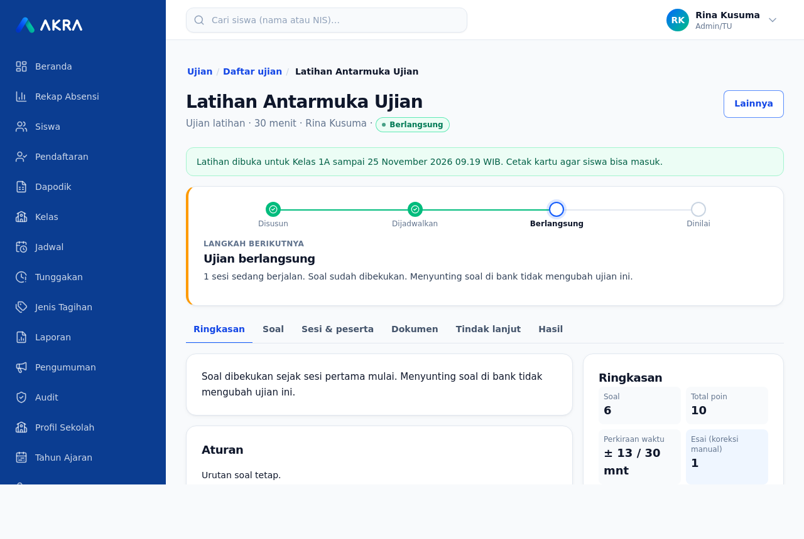

# Panduan Guru: Ulangan Online

Dari bank soal sampai nilai masuk rapor. Waktu baca ± 10 menit.

## 1. Bank soal

Menu **Ujian → Bank soal**. Satu bank untuk satu mapel dan tingkat, mis. "Matematika Kelas 7". Bank dipakai bersama guru mapel itu. Yang bisa mengubah soal hanya pembuatnya dan admin TU; guru lain bisa memakai dan menduplikat.

- Mulai dari **bank Contoh** untuk melihat semua jenis soal: pilihan ganda, PG kompleks, benar/salah, isian, menjodohkan, dan esai, termasuk rumus dan gambar.
- **Tambah soal** satu per satu. Rumus ditulis lewat tombol rumus di editor; gambar diunggah langsung (PNG/JPEG/WebP/GIF, maks. 5 MB).
- Isi **TP** (tujuan pembelajaran), tingkat kesulitan, dan level kognitif. Hasilnya dipakai di analisis setelah ujian.
- **Draf** belum bisa dipakai di ujian. Ubah status ke **Siap** setelah soal dicek. Bila sekolah mengaktifkan telaah soal, tekan **Ajukan telaah** dan tunggu persetujuan.

### Impor dari Word, Excel, atau Moodle

Buka bank → **Impor**. Unduh **template resmi** dulu agar format soal terbaca.

| Format | Cocok untuk | Catatan |
|---|---|---|
| Word (.docx) | Soal yang sudah diketik guru | Soal bernomor, opsi A–E, baris `Kunci:`. Rumus Equation Word, gambar, tabel, dan teks Arab ikut terbaca |
| Excel (.xlsx) | Soal yang disusun bersama (MGMP) | Satu baris satu soal; rumus ditulis `\( … \)`; gambar tidak didukung |
| Moodle XML / GIFT | Pindahan dari Moodle | Kategori menjadi tag |

Setelah **Baca file**, AKRA menampilkan pratinjau setiap soal. Perbaiki soal yang ditandai merah, lalu simpan. Maks. 20 MB dan 500 soal per file.

### Tujuan pembelajaran (TP)

**Bank soal → Tujuan pembelajaran**. Tempel daftar TP dari dokumen kurikulum (satu TP per baris: kode lalu deskripsi), lalu kaitkan setiap soal ke TP-nya.

## 2. Ujian latihan dulu

Sebelum ulangan pertama, buka **Ujian → Ujian latihan**, pilih kelas, lalu tekan **Buka latihan**. Cetak kartu, dan siswa mencoba ragu-ragu, daftar soal, offline, dan kumpul. Latihan dibuka 3 hari dan boleh dicoba dari rumah. Kartu latihan selalu tercetak dengan panduan peserta di baliknya.

## 3. Membuat ulangan

**Ujian → Daftar ujian → Ulangan**. Wizard lima langkah; ujian tersimpan sebagai draf sejak langkah pertama.

1. **Dasar**: tujuan, mapel, tingkat, durasi.
2. **Soal**: pilih soal dari bank, atau tulis aturan ambil acak (mis. 10 PG mudah dari TP 1.1). **Varian paket** (A/B/C) membagi soal berbeda dengan komposisi sama kepada peserta bersebelahan.
3. **Aturan**: acak soal/opsi, boleh kembali, **KKTP** (dipakai untuk daftar remedial), kapan hasil dibuka (nilai saja, atau nilai dan pembahasan), dan aturan integritas (kunci setelah beberapa kali keluar halaman).
4. **Jadwal & peserta**: kelas, tanggal, jam, dan **lokasi**. *Di ruang*: perangkat berbunyi bila siswa keluar halaman. *Jarak jauh*: siswa mengerjakan dari rumah.
5. **Cek & jadwalkan**: AKRA memeriksa soal, kunci, jadwal, dan peserta. Perbaiki yang merah, lalu jadwalkan.

Tanda **?** di samping istilah membuka penjelasan singkat.

## 4. Kartu peserta

Detail ujian → tab **Dokumen** → **Cetak kartu** per sesi (mulai H-3). Centang **Panduan peserta di balik kartu** lalu cetak bolak-balik. Siswa masuk dengan NIS dan kode di kartu.

## 5. Saat ulangan berlangsung

Buka **Ujian → Sesi saya → Layar pengawas** (guru yang membuat ulangan otomatis menjadi pengawasnya). Lihat [pengawas.md](pengawas.md).

## 6. Koreksi dan hasil

- **Koreksi esai**: detail ujian → **Hasil** → **Koreksi esai**. Jawaban tampil tanpa nama (anonim) secara bawaan; isi poin dan komentar, lalu **Simpan & berikutnya**. Soal lain dinilai otomatis.
- **Analisis butir**: tingkat kesukaran (p), daya beda (D), dan sebaran opsi. Soal dengan D negatif atau kunci mencurigakan bisa **diperiksa/dibetulkan kuncinya**, lalu dinilai ulang.
- **Analisis TP**: persentase siswa tuntas per TP. Dari sini buat **remedial** atau **pengayaan** (tab Tindak lanjut).
- **Buka hasil untuk siswa & orang tua**: setelah semua sesi selesai (termasuk susulan). Siswa melihat nilai, atau nilai dan pembahasan, sesuai aturan.

## 7. Kirim nilai ke rapor

Detail ujian → **Kirim ke rapor**. Pilih komponen nilai tujuan, periksa **pratinjau per siswa**, lalu kirim.

- Remedial tidak pernah menurunkan nilai dan dibatasi KKM. Beberapa ulangan ke komponen yang sama dirata-rata.
- Siswa yang tidak hadir dan jawaban yang menunggu koreksi esai tidak diubah.
- Bila nilai berubah setelah dikirim (mis. kunci dibetulkan), AKRA menandai bahwa nilai perlu dikirim ulang.

## Bila ada masalah

**Ujian → Butuh bantuan?** berisi langkah cepat untuk masalah yang sering terjadi.
