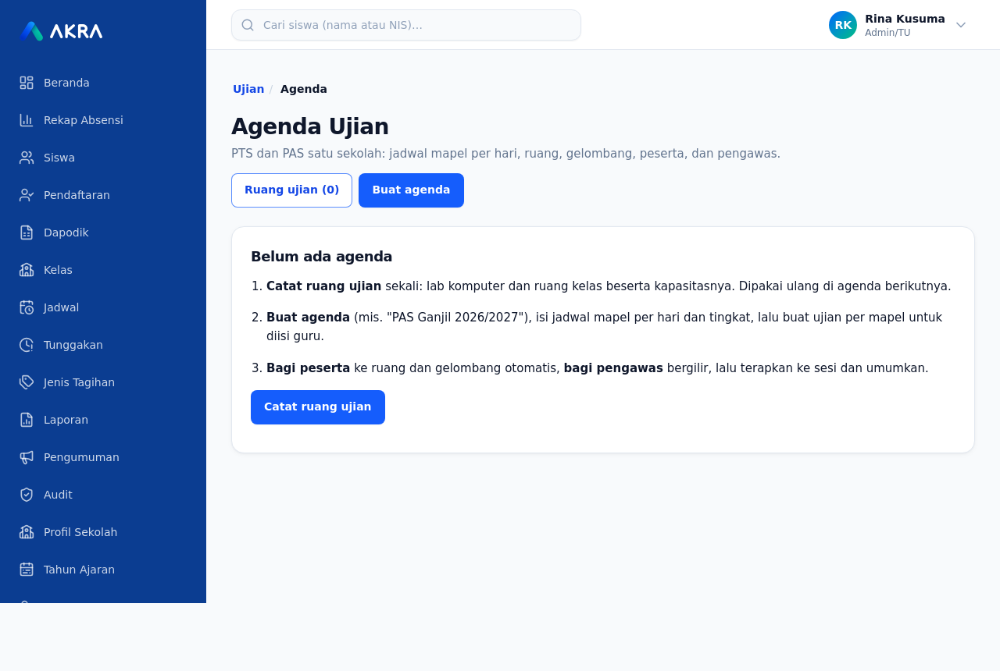

# Panduan Koordinator Ujian: PTS/PAS Satu Sekolah

Untuk koordinator ujian dan admin TU. Koordinator ditunjuk di **Pengaturan → Tugas** untuk tahun ajaran aktif.

## Gambaran

Satu agenda (mis. "PAS Ganjil 2026/2027") berisi jadwal mapel per hari, ruang, gelombang, peserta, pengawas, dan kartu. Guru mapel mengisi soal ujian mapelnya; koordinator mengatur pelaksanaannya.

## Persiapan (H-14 sampai H-3)

1. **Catat ruang ujian** (sekali, dipakai ulang): lab komputer dengan kapasitas = jumlah komputer yang berfungsi, dan ruang kelas untuk peserta yang memakai HP.
2. **Buat agenda**: nama, PTS/PAS, tanggal, dan tingkat.
3. **Jadwal**: tambah jam per hari dan tingkat (mis. Senin 07.30–09.00 Matematika kelas 7), lalu **Buat ujian** untuk setiap mapel. Ujian itu muncul di daftar ujian guru pengampu untuk diisi soalnya.
4. **Pembagian ruang**: **Bagi peserta otomatis** ke ruang dan gelombang sesuai kapasitas. Lab dengan kursi lebih sedikit dari peserta dibuat beberapa gelombang. **Atur tempat duduk** bila perlu.
5. **Pengawas**: **Isi pengawas yang kosong** membagi pengawas bergilir. Hak pengawas berlaku 30 menit sebelum sampai 2 jam sesudah sesinya.
6. **Kesiapan agenda**: perbaiki semua yang ditandai (ujian belum terjadwal, ruang tanpa pengawas, dan sebagainya), lalu **Terapkan ke sesi ujian** dan **Umumkan jadwal ke siswa**. Jadwal tampil di beranda siswa dan portal orang tua.
7. **Kartu peserta** (mulai H-3, agar kode tidak beredar terlalu lama): per ruang atau kelas. Centang **Panduan peserta di balik kartu** dan cetak bolak-balik (balik di sisi panjang).
8. **Dokumen per ruang**: daftar hadir, berita acara, denah, dan tempelan pintu.
9. **Ujian latihan** untuk semua kelas paling lambat H-3, agar siswa mengenal halaman ujian.
10. Bagikan **panduan pengawas** (Ujian → Bantuan) kepada semua pengawas.

## Hari ujian: pusat kendali

Agenda → **Pusat kendali**. Semua ruang dan sesi hari itu di satu layar:

- **Kesehatan server**: "Server normal", "Server lambat atau bermasalah", atau "Server normal, jaringan sekolah lambat". Yang terakhir berarti masalahnya di Wi-Fi/akses internet sekolah.
- **Aksi untuk beberapa ruang**: jeda, lanjutkan, tambah waktu, dan **kirim pesan** ke layar peserta.
- **Ganti pengawas** atau **pindahkan peserta** ke ruang lain bila ada ruang yang bermasalah.
- **Ralat soal**: batalkan soal yang salah agar poinnya tidak dihitung.
- **Rekap hari ini**: hadir, selesai, dan kejadian per ruang.

Gangguan lebih dari ± 5 menit: **jeda** ruang yang terdampak. Lama jeda dikembalikan ke waktu peserta.

## Sesudah ujian

- Periksa semua **berita acara** sudah ditandatangani pengawas.
- **Susulan** untuk peserta yang tidak hadir: detail ujian → tab **Tindak lanjut**. Jadwal susulan tampil di beranda siswa dan portal orang tua.
- Guru mapel mengoreksi esai, membuka hasil, dan mengirim nilai ke rapor (lihat [guru.md](guru.md)). Hasil baru bisa dibuka setelah semua sesi selesai, termasuk susulan.

## Pengaturan ujian

**Ujian → Pengaturan** (admin TU dan koordinator):

- **Telaah soal**: soal guru harus disetujui penelaah sebelum dipakai.
- **Target proporsi** level kognitif (LOTS/MOTS/HOTS) dan kesulitan untuk kisi-kisi dan cek mutu.

## Tes seleksi calon siswa (admin TU)

Ujian → Daftar ujian → **Tes seleksi**. Nilai masuk ke peringkat pendaftaran. Calon siswa tidak melihat nilai maupun pembahasan. Kartu tes tampil di halaman status pendaftaran, lengkap dengan tautan **Cek perangkat** dan **Panduan orang tua**. Ujian latihan untuk calon siswa bisa dibuka dari halaman tes di menu Pendaftaran.

## Bila ada masalah

- **Ujian → Butuh bantuan?** dan tautan yang sama di pusat kendali.
- Status layanan AKRA: `/status`.
