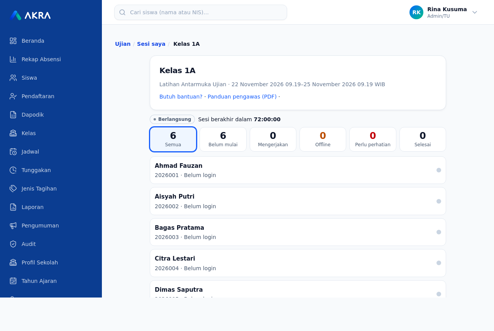

# Panduan Pengawas

Versi cetak 1 halaman: **Ujian → Bantuan → Panduan pengawas** (PDF). Penjelasan bunyi tanda keluar halaman, kunci sementara, dan pindah perangkat ada di [../panduan-pengawas.md](../panduan-pengawas.md).

## Membuka layar pengawas

**Ujian → Sesi saya**. Sesi tampil pada hari ujian bila Anda ditugasi sebagai pengawas. Layar pengawas bisa dibuka mulai 30 menit sebelum sesi. Aksi pengawas berlaku sampai 2 jam sesudah sesi.

Saat pertama dibuka, tur singkat menunjukkan bagian-bagian layar. Putar ulang dengan **Tur singkat** di bawah judul sesi.

## Arti warna

| Tanda | Arti |
|---|---|
| Titik abu-abu | Belum mulai (belum login atau belum menekan Mulai) |
| Titik hijau | Mengerjakan |
| Titik kuning | Offline. Peserta tetap mengerjakan; jawaban terkirim saat tersambung |
| Titik biru | Selesai (jawaban dikumpulkan) |
| Baris merah | Perlu perhatian: keluar halaman, terkunci, atau mencoba masuk dari perangkat lain |
| Bingkai kuning "Baru" | Ada kejadian baru sejak dilihat terakhir |

Ketuk angka di ringkasan status untuk menyaring peserta.

## Aksi per peserta

Ketuk nama peserta:

| Aksi | Kapan |
|---|---|
| Izinkan pindah perangkat | HP mati, rusak, atau baterai habis. Peserta masuk lagi di perangkat lain dengan kode yang sama |
| Reset login (kode baru) | Kartu hilang, atau kode salah 5 kali. Kode baru hanya tampil sekali; diktekan kepada peserta |
| Buka kunci | Layar terkunci setelah beberapa kali keluar halaman. Periksa peserta dulu |
| Tambah waktu | Waktu peserta terbuang karena gangguan. Isi alasannya |
| Kumpulkan | Menghentikan peserta (mis. pelanggaran berat). Peserta tidak bisa melanjutkan |

Isi **alasan**: alasan masuk ke berita acara.

## Aksi sesi

Jeda dan lanjutkan semua peserta, tambah waktu semua, wajibkan atau lepas token, tutup sesi, dan catat kejadian. Setelah sesi selesai, isi catatan lalu **tandatangani berita acara** dengan sandi akun Anda.

## Bila ada masalah

Tautan **Butuh bantuan?** di bawah judul sesi berisi langkah cepat untuk masalah yang sering terjadi.
